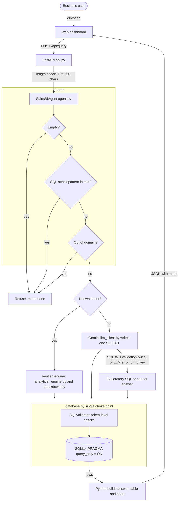
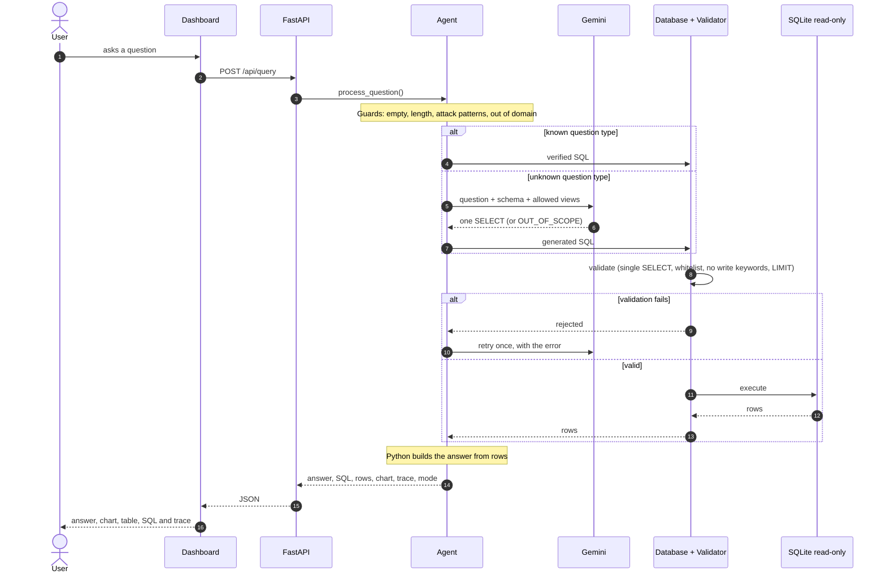

# Architecture

## 1. Overview

The app turns a plain-English question into a validated SQL query, runs it on a read-only SQLite database, and builds the answer from the returned rows. A request goes through a few guards, then one of two paths:

- **Verified engine**: fixed SQL for known question types.
- **Gemini text-to-SQL**: the model writes one SELECT for questions the router does not recognise.

Both paths run their SQL through the same validator, in the same place (`database.py`).

## 2. Request flow

## 3. Components

| File | Role |
|---|---|
| `src/etl.py` | Loads the CSV, normalises dates, imputes the missing price, flags returns and zero quantity, writes the audit log |
| `src/database.py` | Opens read-only connections and validates every query before it runs |
| `src/sql_validator.py` | Token-level validation with `sqlparse`, table whitelist, `LIMIT` enforcement |
| `src/analytical_engine.py` | Intent detection and the verified SQL for the five benchmark questions |
| `src/breakdown.py` | Verified SQL for filtered, ranked and grouped questions; filter values are matched against values in the database and SQL comes from fixed templates |
| `src/llm_client.py` | Calls Gemini through the `google-genai` SDK; 15 second timeout; strips code fences |
| `src/agent.py` | Guards, routing between engine and Gemini, retry and fallback, answer formatting |
| `src/api.py` | HTTP endpoints, request limits, response model |
| `static/` | Dashboard: KPI cards, Chart.js chart, data table, SQL and trace panel |

## 4. Why two paths

Known questions use fixed SQL, so their answers are exact and repeatable. The five benchmark answers always come from this path, and so do filtered, ranked and grouped questions such as "top 3 regions" or "units sold per product", whose SQL is built from fixed templates. Gemini adds flexibility for other questions, but its SQL cannot be trusted blindly, so it is validated, run read-only, and displayed for checking. If anything goes wrong, the system degrades to the verified engine or a clear "cannot answer" message, never to a made-up answer.

## 5. Defense in depth

1. **Question text**: empty, over 500 characters, and SQL-attack phrases are rejected before any query exists.
2. **Validator**: one statement, SELECT only, write and admin keywords blocked, tables limited to `sales_transactions`, `v_completed_sales`, `data_quality_audit`, and `LIMIT 1000` added if missing.
3. **Engine lock**: connections use `PRAGMA query_only = ON`, so even a missed case cannot change data.
4. **Output**: numbers come from Python formatting of returned rows, never from model text.

## 6. Preventing wrong or unsupported answers

| Risk | Mitigation |
|---|---|
| Wrong revenue (returned order included) | Revenue SQL targets `v_completed_sales`; the Gemini prompt requires it |
| Model invents numbers | The model only writes SQL; Python builds the sentence from rows |
| Destructive or invalid SQL | Validator plus read-only connection |
| Off-topic question | Keyword guard plus the model's `OUT_OF_SCOPE` reply |
| Model unavailable, bad key, retired model | Falls back to the verified engine or says it cannot answer |
| User cannot judge the answer | SQL, rows, mode and reasoning trace are always returned |

## 7. Mapping to common agent frameworks

- The loop (guard, choose a tool, run it, observe the rows, write the answer) matches a ReAct-style agent. In LangGraph it would be a graph with a router node, a SQL tool node, a validator node, and a retry edge.
- Google ADK would model the engine and the SQL runner as tools for a single agent.
- RAG is not needed here: the data is structured and the retrieval is exact SQL. Retrieval over a table with a query is closer to "vectorless" retrieval than to embedding search. Embeddings would only help for a text corpus such as a business glossary, which this project does not have.