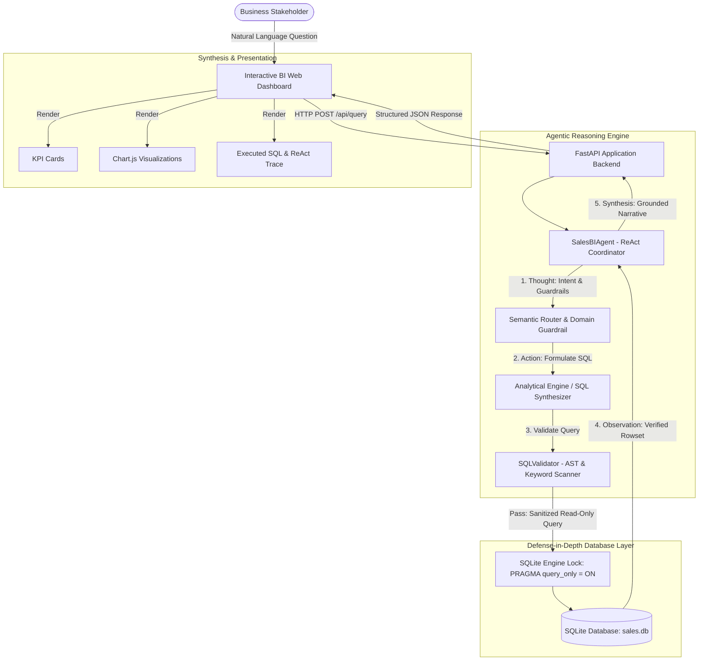
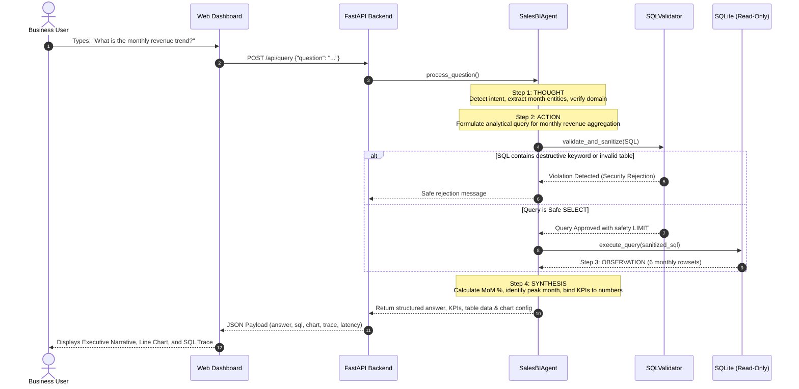

# System Architecture

## 1. High-Level Architecture Overview
The Mini AI Business Intelligence Assistant is designed with a **layered, decoupled ReAct (Reasoning + Acting) architecture**. It bridges natural language queries from business stakeholders to deterministic database execution while enforcing zero-trust data safety and anti-hallucination guardrails.



---

## 2. ReAct (Reasoning + Acting) Cycle

The assistant implements an explicit multi-step ReAct loop:



---

## 3. Defense-in-Depth SQL Security
To satisfy strict enterprise security requirements and eliminate risk of data tampering or SQL injection:

1. **Token & AST Inspection (`SQLValidator`)**:
   - Every statement is parsed using `sqlparse`.
   - Piggyback / multi-statement queries (`SELECT ...; DROP TABLE ...`) are rejected immediately.
   - Prohibits non-`SELECT` statement types (`DROP`, `DELETE`, `UPDATE`, `INSERT`, `ALTER`, `CREATE`, `REPLACE`, `ATTACH`, `DETACH`, `TRUNCATE`, `EXEC`, `PRAGMA`, `GRANT`, `REVOKE`).

2. **Schema Entity Whitelisting**:
   - Queries are only permitted to reference explicit analytical entities: `sales_transactions`, `v_completed_sales`, and `data_quality_audit`.
   - Access to internal SQLite tables (`sqlite_master`, `sqlite_sequence`) is denied.

3. **Database Engine Enforcement**:
   - Every analytical connection is initialized with:
     ```sql
     PRAGMA query_only = ON;
     ```
   - Even if a malicious command bypassed software regex and AST validation, SQLite's storage engine will throw a fatal `sqlite3.OperationalError: attempt to write a readonly database`.

4. **Resource Bounds**:
   - If a query lacks an explicit `LIMIT` clause, `SQLValidator` automatically appends `LIMIT 1000` to prevent memory exhaustion and Denial-of-Service.

---

## 4. Preventing Hallucinations & Incorrect Answers

| Challenge | Prevention Mechanism |
| :--- | :--- |
| **Hallucinated numbers** | Answers are synthesized strictly from the executed query's rowset. Numbers are formatted directly from database aggregates. |
| **Invalid question types** | Out-of-domain questions (e.g. weather, politics, recipes) trigger guardrails that redirect the user to business intelligence topics. |
| **Data anomalies & dirty data** | ETL pipeline automatically imputes missing catalog prices, flags returned items, detects zero quantities, and logs every action in `data_quality_audit`. |
| **Full auditability** | Every response exposes the exact SQL query executed, the latency in milliseconds, and the step-by-step ReAct reasoning trace. |
