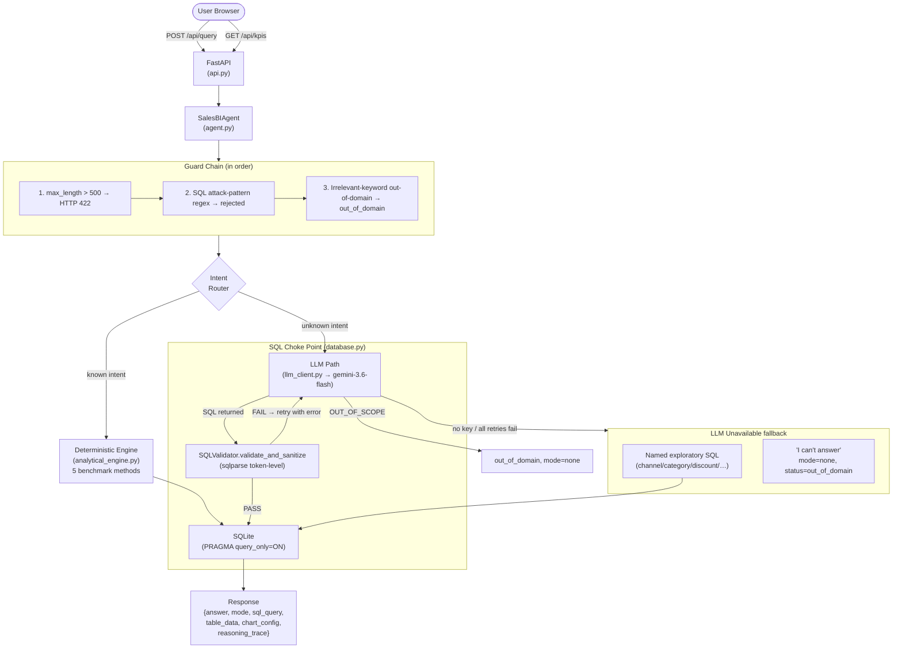
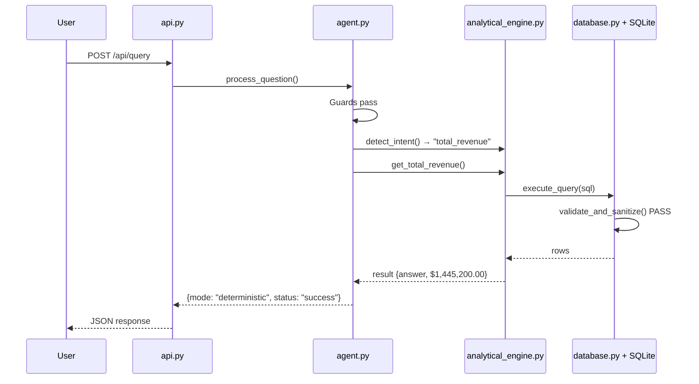
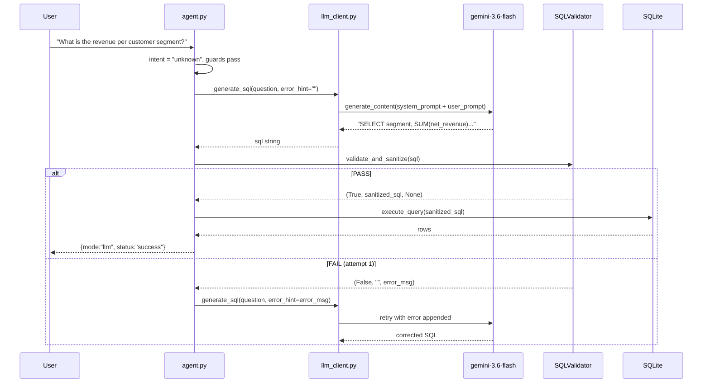

# Architecture

## System Overview



---

## Guard Order in `process_question()`

| Step | Condition | Result |
|---|---|---|
| 1 | `len(question) > 500` | HTTP 422 (Pydantic `max_length`) |
| 2 | SQL attack pattern in text | `status: rejected, mode: none` |
| 3 | Irrelevant keyword AND `intent==unknown` | `status: out_of_domain, mode: none` |
| 4 | `intent != "unknown"` | → Deterministic engine (step 7) |
| 5a | LLM returns `OUT_OF_SCOPE` | `status: out_of_domain, mode: none` |
| 5b | LLM returns valid SQL | validate → execute → `mode: llm` |
| 5c | LLM retry | feed validation error back in user_prompt |
| 5d | All retries fail | → step 6 |
| 6 | Named exploratory keyword present | → exploratory SQL branch, `mode: deterministic` |
| 6 | No keyword, no LLM | `"I can't answer…"`, `mode: none` |
| 7 | Deterministic engine | verified fixed SQL, `mode: deterministic` |

---

## SQL Validation Choke Point

Every SQL statement — from the deterministic engine, the LLM, or an exploratory branch — passes through `DatabaseManager.execute_query()`, which calls `SQLValidator.validate_and_sanitize()` before touching SQLite.

```
SQLValidator (sqlparse token-level)
  ├── Single SELECT statement only
  ├── Dangerous keyword blacklist (DROP, DELETE, UPDATE, INSERT, ALTER, TRUNCATE…)
  ├── Table whitelist (v_completed_sales, sales_transactions, data_quality_audit)
  └── PASS → SQLite with PRAGMA query_only = ON
```

---

## Sequence: Known Question (e.g. "What is the total revenue?")



---

## Sequence: Unknown Question (LLM path)



---

## mode Field

Every `/api/query` response includes `mode`:

| Value | Meaning |
|---|---|
| `"deterministic"` | Answered by verified fixed SQL (benchmark or named exploratory) |
| `"llm"` | Answered by Gemini-generated SQL, validated before execution |
| `"none"` | Rejected, out_of_domain, invalid_request, or error — no SQL ran |

---

## File Map

| File | Responsibility |
|---|---|
| `src/config.py` | Paths, catalog prices, LLM settings; loads `.env` via `python-dotenv` |
| `src/database.py` | SQLite connection; **validator choke point** in `execute_query()` |
| `src/sql_validator.py` | Token-level `sqlparse` validation; `SQLValidationError` |
| `src/etl.py` | CSV → SQLite ETL; imputation; audit logging |
| `src/analytical_engine.py` | 5 deterministic benchmarks + keyword intent router |
| `src/llm_client.py` | `google-genai` wrapper; `OUT_OF_SCOPE` detection; fence stripping |
| `src/agent.py` | ReAct loop; all guards; LLM retry; mode field |
| `src/api.py` | FastAPI; `QueryResponse` with `mode`; 500-char limit |
| `static/` | Web UI: HTML, CSS, Chart.js |
| `tests/` | 59 automated tests across 6 suites |
