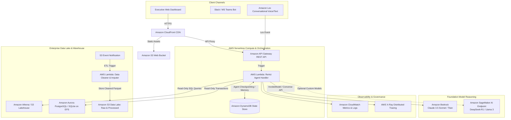

# Enterprise Cloud Deployment: AWS Agentic Architecture

This document describes how this Mini AI Business Intelligence Assistant maps directly to an enterprise-grade, serverless **AWS Autonomous Agent Architecture** utilizing **Amazon Bedrock**, **AWS Lambda**, **Amazon Lex**, and **Amazon S3**.

---

## 1. Cloud Architecture Blueprint



---

## 2. Key AWS Service Mappings

### A. Conversational Interface: Amazon Lex
- **Role**: Serves as the natural language front-door for omni-channel interactions (web chat, Slack, telephony).
- **Configuration**:
  - Intent: `SalesQueryIntent` with fallback slots.
  - Fulfillment: Connects directly via AWS Lambda initialization and validation hooks.

### B. Serverless Execution: AWS Lambda
- **Role**: Runs the containerized Python ReAct agent logic without maintaining long-running server infrastructure.
- **Packaging**: Deployed as an AWS Lambda Container Image (OCI) containing Python 3.13, FastAPI (via Mangum adapter), and the safety validator.
- **Cold Start Optimization**: Configured with AWS Lambda SnapStart or Provisioned Concurrency.

### C. Foundation Reasoning: Amazon Bedrock
- **Role**: Provides state-of-the-art LLM reasoning for text-to-SQL synthesis, query refinement, and business explanations.
- **Model Choice**: `anthropic.claude-3-5-sonnet` or `amazon.titan-text-express` via the Bedrock Converse API.
- **Zero-Data Retention**: Complies with SOC 2, HIPAA, and ISO enterprise standards where customer data is not used for base model training.

### D. Data Storage & Lakehouse: Amazon S3 & Amazon Athena
- **Data Lake (S3)**: Stores raw CSV sales transactions (`s3://company-bi-lake/raw/`) and partitioned, compressed Apache Parquet datasets (`s3://company-bi-lake/processed/year_month=2026-01/`).
- **Query Engine (Athena)**: Executes distributed Presto/Trino SQL queries directly on S3 without database management overhead.
- **Relational DB Option**: Amazon Aurora Serverless (PostgreSQL) with read-only IAM database authentication.

### E. Agent State & Memory: Amazon DynamoDB
- **Short-Term Memory**: Stores conversation session histories and checkpoint states across multi-turn interactions.
- **TTL (Time to Live)**: Automatically expires transient sessions after 24 hours to reduce storage costs.

---

## 3. Sample AWS Lambda ReAct Handler Implementation

```python
import os
import json
import boto3
from src.agent import SalesBIAgent
from src.sql_validator import SQLValidator

s3_client = boto3.client('s3')
bedrock_client = boto3.client('bedrock-runtime', region_name=os.getenv('AWS_REGION', 'us-east-1'))

def lambda_handler(event, context):
    """
    AWS Lambda entrypoint triggered by Amazon API Gateway or Amazon Lex.
    """
    try:
        # Parse query from API Gateway or Lex event
        if "body" in event:
            body = json.loads(event["body"])
            question = body.get("question", "")
        elif "currentIntent" in event: # Lex V1/V2 trigger
            question = event["inputTranscript"]
        else:
            question = event.get("question", "")

        # Initialize agent
        agent = SalesBIAgent()
        response = agent.process_question(question)

        return {
            "statusCode": 200,
            "headers": {
                "Content-Type": "application/json",
                "Access-Control-Allow-Origin": "*"
            },
            "body": json.dumps(response)
        }
    except Exception as e:
        return {
            "statusCode": 500,
            "body": json.dumps({"error": str(e)})
        }
```

---

## 4. CI/CD Deployment with GitHub Actions

The repository includes a ready-to-run GitHub Actions workflow (`.github/workflows/deploy.yml`):
1. **Lint & Test**: Runs `pytest` across all 28 automated test suites.
2. **Build Container**: Builds Docker image with Python dependencies and security checks.
3. **Deploy to AWS**: Pushes image to Amazon Elastic Container Registry (ECR) and updates AWS Lambda function code using OIDC credentials.
